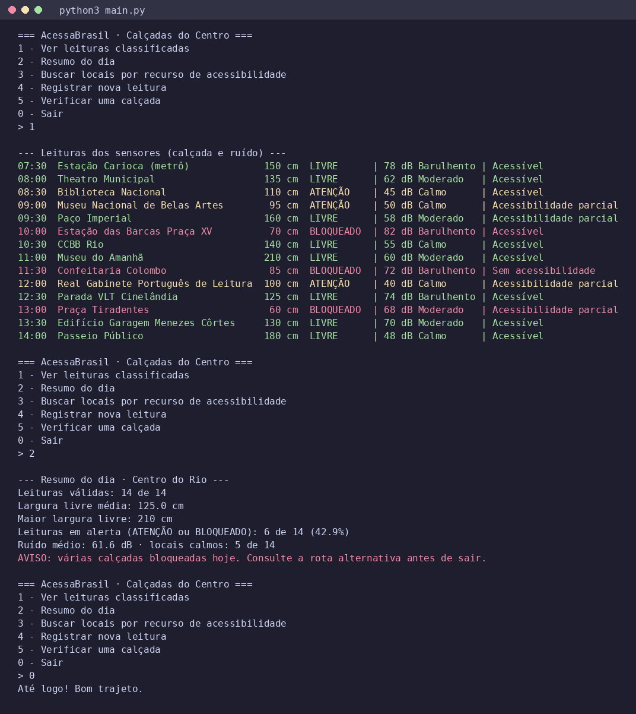
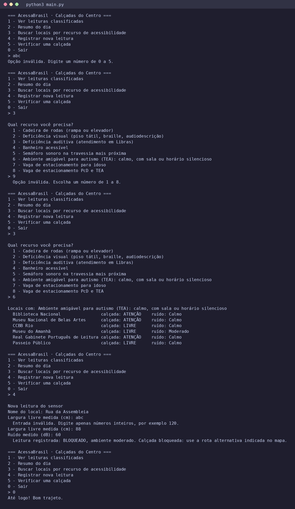

# AcessaBrasil · O Cérebro da CitizenTech (Python)

Global Solution 2026.2 · Computational Thinking with Python · Prof. Cainã Pinel

Este programa é a parte de **lógica** do AcessaBrasil. Ele recebe as leituras dos sensores instalados junto aos semáforos sonoros de pedestres em frente a locais do Centro do Rio: a **largura livre da calçada** (cm) e o **nível de ruído** (dB). O programa classifica cada leitura em faixas, calcula o resumo do dia e decide qual aviso o cidadão vai ver na página. O público inclui pessoas com deficiência física, visual e auditiva, pessoas autistas (TEA) e idosos.

## Como rodar

Requisito: Python 3.8 ou superior (não usa bibliotecas externas).

```bash
cd python
python3 main.py
```

No Windows, use `python main.py`.

## Menu

| Opção | O que faz                                                                                                                                             |
| ----- | ----------------------------------------------------------------------------------------------------------------------------------------------------- |
| 1     | Ver as 14 leituras simuladas: calçada (LIVRE, ATENÇÃO, BLOQUEADO), ruído (Calmo, Moderado, Barulhento) e o tipo do pin no mapa                        |
| 2     | Resumo do dia: média, maior largura livre, % de leituras em alerta, ruído médio, locais calmos e o aviso geral                                        |
| 3     | Buscar locais por recurso: cadeira de rodas, visual, Libras, banheiro, semáforo sonoro, ambiente amigável para autismo, vaga para idoso, vaga PcD/TEA |
| 4     | Registrar uma nova leitura dos sensores (largura e ruído)                                                                                             |
| 5     | Verificar uma calçada: digite a largura e veja o aviso                                                                                                |
| 0     | Sair                                                                                                                                                  |

Qualquer entrada inválida (letras no lugar de números, opção que não existe, campo vazio, fim de entrada) mostra uma mensagem e volta ao menu, sem derrubar o programa.

## Regra de decisão (if/elif/else)

As faixas são as mesmas do circuito no Wokwi (`edge-computing/`) e do JavaScript da página (`frontend-web-development/js/script.js`).

| Largura livre        | Estado    | Por quê                                                                         |
| -------------------- | --------- | ------------------------------------------------------------------------------- |
| 120 cm ou mais       | LIVRE     | Faixa livre mínima de calçada prevista na ABNT NBR 9050                         |
| 90 a 119 cm          | ATENÇÃO   | Uma cadeira de rodas (módulo de referência de 80 cm) passa, mas com dificuldade |
| menos de 90 cm       | BLOQUEADO | Não sobra espaço seguro para a cadeira passar                                   |
| 0 ou acima de 400 cm | INVÁLIDA  | Fora do alcance do sensor HC-SR04, a leitura é descartada                       |

O ruído também é classificado, pensando em pessoas autistas e com sensibilidade sensorial:

| Ruído          | Classe                                                      |
| -------------- | ----------------------------------------------------------- |
| até 55 dB      | Calmo (referência da OMS para áreas externas durante o dia) |
| 56 a 70 dB     | Moderado                                                    |
| acima de 70 dB | Barulhento                                                  |

Os locais também são classificados para o pin do mapa: nenhum recurso = **Sem acessibilidade**, 1 ou 2 recursos = **Acessibilidade parcial**, 3 ou mais = **Acessível**.

## Estrutura do código

| Parte                                                         | O que é                                                                            |
| ------------------------------------------------------------- | ---------------------------------------------------------------------------------- |
| Constantes `LIMITE_LIVRE`, `LIMITE_ATENCAO`, `LEITURA_MAXIMA` | Os limites das faixas, em um só lugar                                              |
| `leituras`                                                    | Lista com 14 dicionários (local, hora, largura, ruído, recursos)                   |
| `classificar_largura()`                                       | A decisão com if/elif/else                                                         |
| `classificar_ruido()`                                         | Calmo, Moderado ou Barulhento                                                      |
| `classificar_local()`                                         | A cor do pin no mapa                                                               |
| `mostrar_resumo()`                                            | Percorre a lista com `for` e calcula média, maior valor, % em alerta e ruído médio |
| `ler_opcao()` e `ler_numero()`                                | Leitura segura do teclado com `try/except`                                         |
| `main()`                                                      | Menu em `while True` até o usuário digitar 0                                       |

## Print da execução

Menu, leituras classificadas e resumo do dia:



Tratamento de entradas inválidas:



## Dados

As 14 leituras são **simuladas**. Os nomes dos locais são reais só para dar contexto; as larguras, o ruído e os recursos de acessibilidade foram criados pela equipe para o protótipo.

## Equipe

| Nome completo                             | RM       |
| ----------------------------------------- | -------- |
| Débora Gonçalves da Silva                 | RM575926 |
| Pedro Paulo Carvalho Coutinho             | RM575957 |
| Vanessa Santos Martins de Lima Nascimento | RM576450 |

O registro do uso de IA está em [prompts.md](prompts.md).
